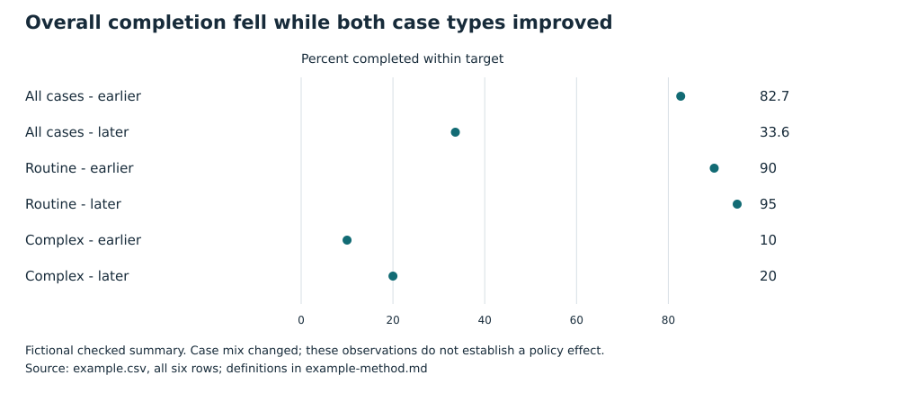

# Don't infer a policy effect from the overall decline alone

Fictional worked example for an operations lead. Question: does the reported aggregate fall justify reversing the service policy?

The checked records do not identify a policy effect. Overall completion fell while both recorded case types improved, and the case mix changed substantially. Review comparable within-type outcomes and case mix before deciding whether to reverse the policy. This is a recommendation, not a decision already taken. [Method and limits](example-method.md)

## What the checked summary shows

Completion within the target fell from 82.7% to 33.6% overall. Routine cases rose from 90% to 95%; complex cases rose from 10% to 20%. In the earlier period, 100 of 110 cases were routine; in the later period, only 20 of 110 were routine. Complex cases have the lower recorded completion rate in both periods. [Source: all six keyed rows](example.csv)

| Group | Earlier completion | Later completion | Earlier cases | Later cases |
|---|---:|---:|---:|---:|
| All cases |82.7%|33.6%|110|110|
| Routine |90%|95%|100|20|
| Complex |10%|20%|10|90|

The table and plot use the reported rates directly. Completion means cases finished within the defined target after equal complete follow-up. Counts and rates come from the same supplied summary; no source value was changed to produce the graphic. [Definitions](example-method.md)

## What this means for the decision

The aggregate answers a different question from either within-type rate because the relative numbers of routine and complex cases changed. It would be misleading to treat the overall decline alone as proof the policy harmed service. It would also be misleading to call the within-type increases proof that the policy helped. The analysis is descriptive and lacks a design that identifies either causal claim. [Analysis limits](example-method.md)

Recommendation: retain both aggregate and case-type views in the next policy review, then establish whether case severity, assignment or other conditions differ before choosing a reversal. Do not promise a benefit or savings from this evidence. The next useful evidence is an analysis with an appropriate comparable design and the relevant operating costs, not another polished version of the same aggregate chart. The responsible owner and timing remain to be assigned.

This readout supports an informed pause on the causal conclusion. It does not approve rollout, reversal, experimentation, publication or a new data collection action.
