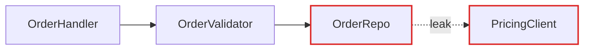

# HTML Report Format

Render one offline, self-contained HTML file at the output location chosen by [the architecture playbook](../../playbooks/improve-codebase-architecture.md). Use embedded CSS and SVG; no external scripts, fonts, images, or network calls. Mermaid is an optional authoring language only when an existing trusted renderer can convert it to embedded SVG. Do not install a renderer merely to satisfy this format. Escape project-derived labels as text, never interpolated HTML/script. Inspect diagrams for clipping, contrast, accurate arrows, and readable mobile layout.

## Scaffold

This runnable scaffold demonstrates a complete candidate; replace its example facts with observed repository evidence. Duplicate the article for actual candidates, assigning unique IDs and SVG titles. Keep all evidence local.

```html
<!doctype html>
<html lang="en">
<head>
<meta charset="utf-8"><meta name="viewport" content="width=device-width,initial-scale=1">
<title>Architecture review</title>
<style>
:root{color-scheme:light;font:16px/1.5 system-ui;color:#172033;background:#fafaf9}
body{margin:0}main{max-width:1050px;margin:auto;padding:2rem 1.25rem}
article,.recommendation{background:white;border:1px solid #cbd5e1;border-radius:12px;padding:1.4rem;margin:1.5rem 0}
h1,h2,h3{line-height:1.2}.pair{display:grid;grid-template-columns:1fr 1fr;gap:1rem}
figure{margin:0}svg{display:block;width:100%;height:auto;max-height:320px}figcaption{font-weight:600}
.box{fill:#fff;stroke:#64748b;stroke-width:2}.deep{fill:#172033;stroke:#172033;stroke-width:3}
.seam{stroke:#059669;stroke-width:2;stroke-dasharray:5 4;fill:none}.leak{stroke:#dc2626;stroke-width:2;fill:none}
svg text{font:14px system-ui;fill:#172033}.light{fill:#fff}code{overflow-wrap:anywhere}
.badge{padding:.2rem .55rem;border-radius:4px;background:#d1fae5}.warning{padding:.7rem;background:#fef3c7}
a{color:#075985}@media(max-width:650px){.pair{grid-template-columns:1fr}}
</style></head>
<body><main>
<header><h1>Architecture review: example Order module</h1><p>Date and inspected revision: replace with evidence.</p>
<p>Solid box: module · Dashed line: seam · Red arrow: leakage · Dark box: deep module</p></header>
<section aria-label="Candidates"><article id="order-intake">
<h2>Collapse the Order intake pipeline</h2><p><span class="badge">Worth exploring</span> · in-process</p>
<p>Files: <code>order/validate.ts</code>, <code>order/price.ts</code>, <code>order/intake.ts</code> (illustrative)</p>
<div class="pair">
<figure><figcaption>Before: callers coordinate three modules</figcaption>
<svg viewBox="0 0 420 220" role="img" aria-labelledby="before-title"><title id="before-title">Order caller repeats validation and pricing coordination</title>
<rect class="box" x="120" y="10" width="180" height="42"/><text x="155" y="36">Order caller</text>
<path class="leak" d="M160 52 L70 110 M210 52 L210 110 M260 52 L350 110"/>
<rect class="box" x="10" y="110" width="120" height="48"/><text x="28" y="140">Validation</text>
<rect class="box" x="150" y="110" width="120" height="48"/><text x="180" y="140">Pricing</text>
<rect class="box" x="290" y="110" width="120" height="48"/><text x="320" y="140">Intake</text>
<text x="45" y="195">Ordering knowledge leaks into each caller</text></svg></figure>
<figure><figcaption>After: callers cross one interface</figcaption>
<svg viewBox="0 0 420 220" role="img" aria-labelledby="after-title"><title id="after-title">Order intake hides coordination behind one interface</title>
<rect class="box" x="120" y="10" width="180" height="42"/><text x="155" y="36">Order caller</text>
<path class="seam" d="M210 52 L210 90 M40 80 L380 80"/>
<rect class="deep" x="40" y="95" width="340" height="100"/><text class="light" x="125" y="127">Order intake module</text>
<text class="light" x="70" y="165">Validation · pricing · coordination</text></svg></figure>
</div>
<p><strong>Problem:</strong> Each caller repeats ordering knowledge.</p>
<p><strong>Solution:</strong> One Order intake interface hides coordination.</p>
<ul><li>Tests exercise one interface</li><li>Locality: ordering changes concentrate</li></ul>
</article></section>
<section class="recommendation"><h2>Top recommendation</h2><p><a href="#order-intake">Order intake</a>: investigate whether repeated coordination can be hidden without losing required caller flexibility.</p></section>
</main></body></html>
```

## Header

Repo name, date, and a compact legend: solid box = module, dashed line = seam, red arrow = leakage, thick dark box = deep module. No introduction paragraph. Straight into the candidates.

## Candidate card

The diagrams carry the weight. Prose is sparse, plain, and uses the glossary terms (from the `/codebase-design` skill) without ceremony.

Each candidate is one `<article>`:

- **Title**: short, names the deepening (e.g. "Collapse the Order intake pipeline").
- **Badge row**: recommendation strength (`Strong` = emerald, `Worth exploring` = amber, `Speculative` = slate), plus a tag for the dependency category (`in-process`, `local-substitutable`, `ports & adapters`, `mock`).
- **Files**: monospaced list, `font-mono text-sm`.
- **Before / After diagram**: the centrepiece. Two columns, side by side. See patterns below.
- **Problem**: one sentence. What hurts.
- **Solution**: one sentence. What changes.
- **Wins**: bullets, ≤6 words each. e.g. "Tests hit one interface", "Pricing logic stops leaking", "Delete 4 shallow wrappers".
- **ADR callout** (if applicable): one line in an amber-tinted box.

No paragraphs of explanation. If the diagram needs a paragraph to be understood, redraw the diagram.

## Diagram patterns

Pick the pattern that fits the candidate. Mix them. Don't make every diagram look the same. Variety is part of the point.

### Mermaid graph (the workhorse for dependencies / call flow)

Use a Mermaid `flowchart` or `graph` when the point is "X calls Y calls Z, and look at the mess." Render it offline to inline SVG and wrap it in a locally styled card so it doesn't feel parachuted in. Style with classDef to colour leakage edges red and the deep module dark. Sequence diagrams work well for "before: 6 round-trips; after: 1."



### Hand-built boxes-and-arrows (when Mermaid's layout fights you)

Modules as `<div>`s with borders and labels. Arrows as inline SVG `<line>` or `<path>` elements positioned absolutely over a relative container. Reach for this when you want the "after" diagram to feel like one thick-bordered deep module with greyed-out internals, since Mermaid won't render that with the right weight.

### Cross-section (good for layered shallowness)

Stack horizontal bands (`h-12 border-l-4`) to show layers a call passes through. Before: 6 thin layers each doing nothing. After: 1 thick band labelled with the consolidated responsibility.

### Mass diagram (good for "interface as wide as implementation")

Two rectangles per module: one for interface surface area, one for implementation. Before: interface rectangle is nearly as tall as the implementation rectangle (shallow). After: interface rectangle is short, implementation rectangle is tall (deep).

### Call-graph collapse

Before: a tree of function calls rendered as nested boxes. After: the same tree collapsed into one box, with the now-internal calls shown faded inside it.

## Style guidance

- Lean editorial, not corporate-dashboard. Generous whitespace. Serif optional for headings (`font-serif` works well with stone/slate).
- Colour sparingly: one accent (emerald or indigo) plus red for leakage and amber for warnings.
- Keep diagrams ~320px tall so before/after sits comfortably side by side without scrolling.
- Use `text-xs uppercase tracking-wider` for module labels inside diagrams, so they read as schematic, not as UI.
- The delivered report is static and offline: inline CSS and SVG, no app code or third-party scripts. Tailwind-like class names in examples describe styling intent; define them locally if used.

## Top recommendation section

One larger card. Candidate name, one sentence on why, anchor link to its card. That's it.

## Tone

Plain English, concise, but the architectural nouns and verbs come straight from the `/codebase-design` skill. Concision is not an excuse to drift.

**Use exactly:** module, interface, implementation, depth, deep, shallow, seam, adapter, leverage, locality.

**Never substitute:** component, service, unit (for module) · API, signature (for interface) · boundary (for seam) · layer, wrapper (for module, when you mean module).

**Phrasings that fit the style:**

- "Order intake module is shallow: interface nearly matches the implementation."
- "Pricing leaks across the seam."
- "Deepen: one interface, one place to test."
- "Two adapters justify the seam: HTTP in prod, in-memory in tests."

**Wins bullets** name the gain in glossary terms: *"locality: bugs concentrate in one module"*, *"leverage: one interface, N call sites"*, *"interface shrinks; implementation absorbs the wrappers"*. Don't write *"easier to maintain"* or *"cleaner code"*, because those terms aren't in the glossary and don't earn their place.

State uncertainty when the evidence is incomplete; no throat-clearing, no "it's worth noting that…". If a sentence could be a bullet, make it a bullet. If a bullet could be cut, cut it. If a term isn't in the `/codebase-design` glossary, reach for one that is before inventing a new one.
